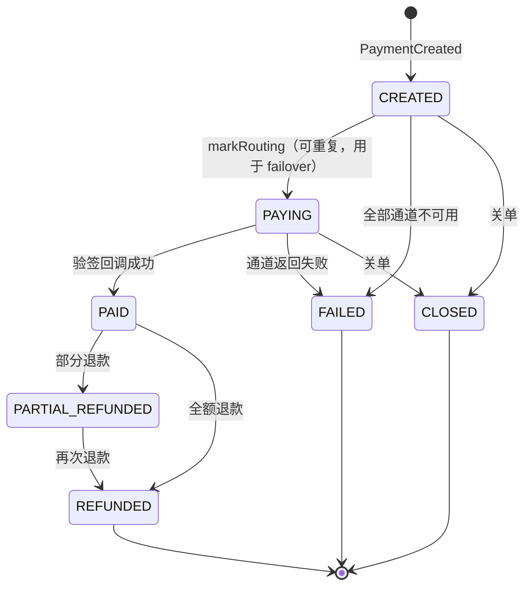
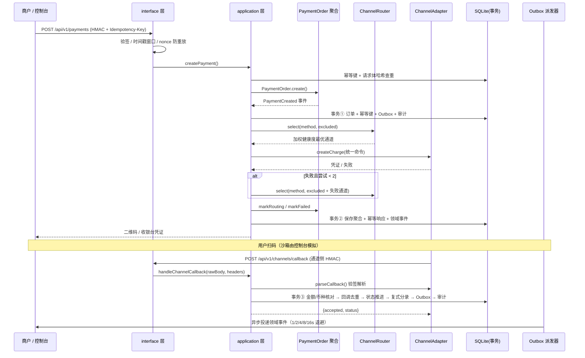

# PivotPay DDD 设计与高可用说明

## 一、为什么用 DDD

支付系统的复杂度不在 CRUD，而在**业务不变量与跨系统一致性**：订单不能回退状态、退款不能超实付、回调不能重复入账、通知不能丢、通道路由要能自动摘除故障节点。这些规则如果散落在 Controller 与 SQL 里，很快会失控。

本项目把规则收进 `PaymentOrder` 聚合根，把外部支付机构隔离在 `ChannelAdapter` 端口之后，把跨上下文协作交给领域事件 + Outbox，形成可验证、可演练的结构。

## 二、限界上下文地图

```mermaid
flowchart LR
  subgraph Core[核心域]
    P[payment<br/>PaymentOrder 聚合根<br/>状态机 / 幂等]
    R[routing<br/>加权路由 / 三态熔断]
  end
  subgraph Supporting[支撑域]
    C[channel<br/>ChannelAdapter ACL<br/>7 个适配器]
    N[notification<br/>Outbox / Webhook 退避]
    L[ledger<br/>复式记账]
    RC[reconciliation<br/>日终对账]
  end
  subgraph Generic[通用域]
    T[tenant<br/>多租户 / 凭据]
    A[audit<br/>审计留痕]
  end
  P -->|选路| R
  R -->|端口调用| C
  P -->|领域事件| N
  P -->|支付成功| L
  P -->|退款| L
  L -->|账目核对| RC
  T -->|租户校验| P
  A -.横切.-> P
  A -.横切.-> N
```



上下文之间通过**应用服务编排 + 数据库内领域事件**协作，不直接引用对方的内部模型；`packages/shared` 只放传输契约类型，不放领域逻辑。

| 上下文 | 聚合 / 核心对象 | 关键不变量 |
| --- | --- | --- |
| payment | `PaymentOrder`（聚合根）、`Money`（值对象） | 状态机合法迁移、退款 ≤ 实付、终态不可逆、租户归属 |
| routing | `ChannelRouter`、`ChannelHealth` | 熔断 OPEN 不参与选路、失败通道当次排除、健康分 ≥ 5 |
| channel | `ChannelAdapter`（端口）、`CreateChargeCommand` | 领域层不感知第三方 SDK；回调必须验签 |
| notification | `OutboxEvent`、`WebhookDelivery` | 事件与业务状态同事务；投递最多 N 次后进死信 |
| ledger | `LedgerEntry` | 每笔分录借贷合计相等 |
| reconciliation | `ReconciliationBatch`、`DiffItem` | 同日重复运行不重复写批次 |
| tenant | `Tenant`、`MerchantApp` | 所有查询强制 `tenant_id`，跨租户 403 |

## 三、共享内核

`apps/api/src/shared/kernel.ts` 提供与业务无关的构件：

- `ValueObject`：按值比较的基类
- `Entity` / `AggregateRoot`：聚合根持有 `domainEvents`，通过 `record()` 累积、`pullDomainEvents()` 一次性取出
- `Money`：金额值对象，整数「分」存储，禁止浮点；`add / subtract / greaterOrEqual`
- `DomainError`：带业务码与 HTTP 状态的领域异常，由全局过滤器统一转成 JSON
- `stableStringify / sha256Hex / hmacHex`：签名与幂等哈希的稳定序列化

## 四、PaymentOrder 状态机



`ALLOWED_TRANSITIONS` 是唯一真相来源，`moveTo()` 拒绝任何未声明的迁移。额外防御：

- `markSucceeded()`：已是 PAID 时直接幂等返回；已退款态收到迟到成功回调 → `CALLBACK_OUT_OF_ORDER`
- `markFailed()`：已成功/已退款订单不能被迟到失败回调覆盖 → `CALLBACK_OUT_OF_ORDER`
- `applyRefund()`：仅 PAID / PARTIAL_REFUNDED 可退；`alreadyRefunded + amount > 实付` → `REFUND_EXCEEDS_PAID`
- `assertTenant()`：跨租户读取 → `TENANT_MISMATCH` (403)

## 五、一次支付的完整时序



**关键顺序**：金额与币种核对在回调去重之前。若先去重，「同流水号 + 篡改金额」的伪造报文会被当成重复回调静默放过，掩盖资金篡改攻击。冒烟测试对此有专门断言。

## 六、高可用设计

### 6.1 加权健康度路由

```
有效权重 = max(1, 静态权重 × healthScore / 100)
healthScore = max(5, 100 − 失败率×100 − min(25, EWMA延迟/40) − (HALF_OPEN ? 30 : 0))
```

候选集过滤：启用 ∧ 支持该支付方式 ∧ 适配器已配置 ∧ 熔断非 OPEN。轮盘赌加权选择，失败通道加入 `excluded` 后立即二次选路（最多 2 次），每次尝试都写入 `payment_attempts` 形成可审计轨迹。

### 6.2 三态熔断器

| 状态 | 行为 |
| --- | --- |
| CLOSED | 正常参与选路；连续失败达 3 次 → OPEN |
| OPEN | 从候选集摘除；冷却 30s 后由定时器转 HALF_OPEN |
| HALF_OPEN | 放行探测流量，成功 → CLOSED，失败 → OPEN |

`channelRouter.tick()` 每 5 秒驱动冷却；`recordSuccess/recordFailure` 更新累计次数、连续失败与 EWMA 延迟。

### 6.3 故障注入演练台

`/api/v1/console/drill` 支持 `force_fail` / `recover` / `open_breaker` / `reset_breaker` / `reset_all` / `force_webhook_fail` / `receiver_down` / `extra_latency`，只修改内存标志与本地健康表。**一键 failover 演练**会强制 3 条通道失败、用真实 HMAC 签名下单、读取 `payment_attempts` 展示形如 `mock_alipay_qr:FAILURE → mock_flaky:SUCCESS` 的切换轨迹，然后自动恢复。

### 6.4 一致性与幂等

| 场景 | 机制 |
| --- | --- |
| 重复下单 | `Idempotency-Key` + 请求体 SHA256；同键同体返回首次结果，同键异体 409 |
| 重复回调 | `channel_code + channel_trade_no + outcome` 唯一约束式去重 |
| 乱序回调 | 聚合状态机拒绝迟到失败 / 迟到成功 |
| 通知丢失 | 订单 + 分录 + Outbox 事件同一事务；后台派发器 1.5s 轮询、指数退避、死信可手动重试 |
| 资金错账 | 复式记账每笔借贷相等；`/console/ledger` 实时校验 |
| 日终差错 | 本地账 vs 通道账单逐笔比对，注入金额不一致 / 单边账三类差异 |

## 七、接口层与横切关注点

- `authenticateMerchant`：HMAC-SHA256 规范串 + 5 分钟时间戳 + nonce 缓存防重放
- `authenticateConsole`：演示用 `X-Tenant-Id` 做租户隔离（生产应换 SSO + RBAC）
- `DomainExceptionFilter`：领域异常 → `{code, message, status}` 统一响应
- `health/live`（进程存活）、`health/ready`（数据库可写 ∧ 至少一条可用通道）、`health/metrics`
- 单端口形态：`main.ts` 在 `apps/web/dist` 存在时挂载静态资源与 SPA fallback

## 八、生产化演进路径

当前是**单进程 + 本地 SQLite** 的可运行教学形态，便于零依赖演示。上生产需替换的点：

| 当前 | 生产替代 | 原因 |
| --- | --- | --- |
| `node:sqlite` 单文件 | PostgreSQL / MySQL + 主从 | 多实例共享、连接池、行级锁 |
| 单事务 Outbox 表 + 进程内轮询 | Outbox + CDC（Debezium）/ 消息队列 | 跨实例可靠投递、至少一次语义 |
| 内存 nonce / 熔断健康表 | Redis（带 TTL） | 多实例共享重放防护与熔断状态 |
| `X-Tenant-Id` 头 | SSO + JWT + RBAC + 租户行级安全 | 防伪造租户、细粒度授权 |
| 明文演示密钥 | KMS / 密钥轮换 / 不可逆哈希 | 凭据泄露防护 |
| Mock 适配器 | 持牌机构官方 SDK + 商户资质 | 真实受理与清算 |
| 单进程 | 多副本 + 负载均衡 + 探针 + 限流 | 消除单点、可滚动发布 |

替换时领域层与聚合根无需改动——这正是端口与适配器隔离的价值：只有 `infrastructure` 与 `channel` 适配层需要重写。
